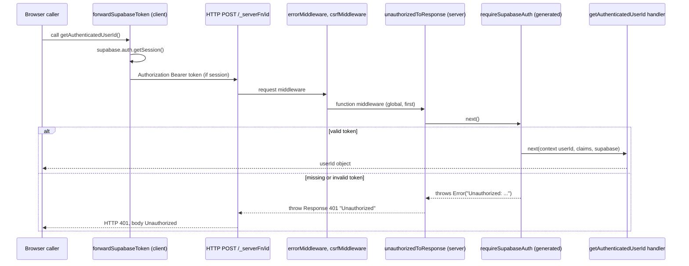

# Design Document

## Overview

This feature adds one protected TanStack Start server function and the client and server plumbing it needs, using only the files Requirement 7.8 allows.

| Piece | File | Role |
| --- | --- | --- |
| `forwardSupabaseToken` | `src/lib/supabase-bearer-middleware.ts` (new) | Client function middleware. Reads the Supabase session in the browser and sends `Authorization: Bearer <token>`. |
| `unauthorizedToResponse` | `src/lib/supabase-bearer-middleware.ts` (new, same module) | Server function middleware. Turns an error whose message starts with `Unauthorized` into a plain `401 Unauthorized` response. |
| `getAuthenticatedUserId` | `src/lib/auth.functions.ts` (new) | Server function protected by `requireSupabaseAuth`. Returns `{ userId }`. |
| Registration | `src/start.ts` (edit) | Adds `functionMiddleware: [forwardSupabaseToken, unauthorizedToResponse]`. |
| Tests | `src/test/*.test.ts` (new) | Vitest tests with a mocked Supabase client. |

The 401 mapping lives in the new module next to the client middleware because both implement the same wire contract (Bearer token in, plain 401 out). It is registered globally, so every server function protected by `requireSupabaseAuth` gets the same rejection shape. No generated file changes, no dependency changes, no UI.

### Resolution of the Open Design Note

`requireSupabaseAuth` throws plain `Error` values whose messages start with `Unauthorized`. The requirements call for HTTP 401 with the body `Unauthorized`. The note proposed extending `errorMiddleware`. That does not work, because `errorMiddleware` never sees these errors (see Framework Findings, F4). The chosen design is a global server function middleware that wraps the per-function middleware and throws a `Response` for matching errors (F5, F6).

## Framework Findings

The workspace has no `node_modules` and `bun` is not installed (`node` and `npm` are), so nothing was read from `node_modules`, and nothing in this design has been executed. Every finding below comes from reading source. The exact versions that `bun.lock` resolves were downloaded with `npm pack` into a temporary directory outside the repository and read there:

- `@tanstack/react-start` 1.168.60 (re-exports `@tanstack/start-client-core`)
- `@tanstack/start-client-core` 1.170.34
- `@tanstack/start-server-core` 1.169.39
- `@tanstack/router-core` 1.171.34
- `@tanstack/start-plugin-core` 1.171.49
- `@tanstack/start-fn-stubs` 1.162.0
- `h3` 2.0.1-rc.20

Nothing in the repository was changed and no `.env` value was printed (only variable names were listed).

| # | Finding | Source (package, file) |
| --- | --- | --- |
| F1 | Imports: `createServerFn`, `createMiddleware`, `createStart`, `createCsrfMiddleware` are all exported from `@tanstack/react-start`. `getRequest` and `setResponseStatus` come from `@tanstack/react-start/server`. | `react-start/dist/esm/index.js`, `server.js` |
| F2 | Client middleware headers: `createMiddleware({ type: "function" }).client(fn)` stores `fn` in `middleware.options.client`. `next({ headers })` accepts `HeadersInit`. Headers are merged with `mergeHeaders(ctx.headers, userCtx.headers)` using `Headers.set`, so a later value for the same name wins. The final `serverFnFetcher` does `new Headers(first.headers)` and sends them on the fetch. | `start-client-core` `createMiddleware.js`, `createServerFn.js` (`userNext`), `client-rpc/serverFnFetcher.js`; `router-core` `ssr/headers.js` |
| F3 | Ordering: `executeMiddleware` builds `flattenMiddlewares([...getStartOptions().functionMiddleware, ...perFunctionMiddleware, serverFnBase])`. Global `functionMiddleware` therefore runs before and wraps any per-function `.middleware([...])`, on both client and server. Entries without a `client` handler are skipped on the client, and entries without a `server` handler are skipped on the server. | `start-client-core` `createServerFn.js` (`executeMiddleware`) |
| F4 | Errors thrown by a server function middleware are caught inside `executeMiddleware` (`catch (error) { return { ...ctx, error } }`). `handleServerAction` then serializes `res.error` into a normal response (`x-tss-serialized: true`, JSON body) with status `getResponse().status`. That value is `undefined` in h3 unless `setResponseStatus` was called, so the HTTP status is 200. The error never propagates to request middleware, so `errorMiddleware` does not run its `catch` for these errors, with or without a `statusCode`. `errorMiddleware` only sees failures that escape `handleServerAction`, such as a throw from `await getServerFnById(...)`, which sits before its `try`. For those, an error with `statusCode` is rethrown and any other error becomes the HTML 500 page. | `start-server-core` `server-functions-handler.js`, `createStartHandler.js`; `h3` `H3EventResponse` |
| F5 | A middleware can short-circuit with a `Response`. A returned `Response` becomes `result`. A thrown `Response` becomes `error`. In `handleServerAction`, `unwrapped = res.error ?? res.result`, and a `Response` is returned as is with `x-tss-raw: true` added (when the request carries `x-tsr-serverFn: true`) or without any marker (when it does not). Status and body are preserved. The `FunctionMiddlewareServerFnResult` type does not include `Response` (the request middleware type does), so a returned `Response` needs a cast. `throw new Response(...)` needs none. | `server-functions-handler.js`; `createMiddleware.d.ts` |
| F6 | `userNext` rethrows `result.error` after calling the downstream chain, so a global middleware can `try { await next() } catch` around `requireSupabaseAuth`. | `createServerFn.js` (`userNext`) |
| F7 | Client handling of a raw response: `serverFnFetcher.getResponse` returns the `Response` immediately when `x-tss-raw` is `true`. The server function call therefore resolves with the 401 `Response` object instead of rejecting. Without the marker, a non-ok `text/plain` response makes the client reject with `new Error(await response.text())`. The framework always sends `x-tsr-serverFn: true` from the client, so the raw path applies. | `client-rpc/serverFnFetcher.js` |
| F8 | `.client()` callbacks also run during SSR when a server function is called from server code (`handler` always runs `executeMiddleware(..., "client", ...)`; on the server the extracted function is an SSR RPC that calls `__executeServer` directly). The client middleware must therefore tolerate running on the server. The start compiler strips `.server()` bodies from `createMiddleware` calls in the client build only. | `createServerFn.js`; `start-plugin-core` `start-compiler/handleCreateMiddleware.js` |
| F9 | Endpoint convention: the base is `/_serverFn/` (`serverFns.base` defaults to `/_serverFn`, joined with the router base path and a trailing slash). The function id is the last segment. In dev it is `base64url(JSON.stringify({ file, export }))` with `export` equal to `<variableName>_createServerFn_handler`. In build mode it is a SHA-256 hash. The compiler replaces the handler in the client module with `createClientRpc("<id>")`, and the resulting server function exposes `.url` (`"/_serverFn/<id>"`). | `start-plugin-core` `schema.js`, `planning.js`, `start-compiler/compiler.js`, `handleCreateServerFn.js`; `start-client-core` `client-rpc/createClientRpc.js` |
| F10 | Method: `handleServerAction` returns 405 when the request method differs from the function's method. The default method is GET. | `server-functions-handler.js` |
| F11 | CSRF: `csrfMiddleware` (filter `handlerType === "serverFn"`) checks `Sec-Fetch-Site` first (default allowed value `same-origin`), then `Origin`, then `Referer`. If none is present and `allowRequestsWithoutOriginCheck` is not set, it returns `403 Forbidden`. A browser `fetch` from the app's own page sends `Sec-Fetch-Site: same-origin`, so calls from the browser console pass. `curl` sends none of these headers and must add one. | `start-client-core` `createCsrfMiddleware.js` |
| F12 | Env loading: in dev the Start Vite plugin copies `loadEnv(mode, root, "")` into `process.env`, so `SUPABASE_URL` and `SUPABASE_PUBLISHABLE_KEY` (both present in `.env` by name) reach `requireSupabaseAuth` without extra setup. | `start-plugin-core` `vite/load-env-plugin/plugin.js` |
| F13 | In an uncompiled Vitest environment, `createIsomorphicFn().server(impl)` returns `impl`. `createCsrfMiddleware` therefore works and `src/start.ts` can be imported in tests. `createMiddleware(...).client(fn).options.client === fn`, so handlers can be called directly in tests. | `start-fn-stubs` `createIsomorphicFn.js`; `createMiddleware.js` |

### Consequences for the design

1. Extending `errorMiddleware` cannot produce the 401 (F4).
2. Setting the status with `setResponseStatus(401)` and rethrowing would yield HTTP 401, but the body would be the serialized error JSON including the message `Unauthorized: No authorization header provided`. That violates Requirements 4.1 and 4.3, so it is rejected.
3. A global function middleware that throws a `Response` for matching errors gives the exact status and body, needs no cast, and leaves every generated file alone (F3, F5, F6).
4. The mapping is global (see Global Scope below). A server function call cannot be made to reject on the client and also carry a plain HTTP 401 body. With the framework's raw-response path the call resolves with the 401 `Response` (F7). `forwardSupabaseToken` must not convert it because Requirement 1.5 requires the result to stay unchanged. Callers that need an error check `response instanceof Response && !response.ok`. This is documented in Error Handling and is out of scope for this feature.

### Global Scope of `unauthorizedToResponse`

`unauthorizedToResponse` sits in `functionMiddleware`, so it wraps every server function, and it changes the outcome for every function that uses `requireSupabaseAuth`: a missing or invalid token now yields a 401 `Response` that the browser call resolves with, instead of a serialized error with HTTP status 200 that makes the call reject. Today `getAuthenticatedUserId` is the only such function (a repository search finds `requireSupabaseAuth` only in its own generated file and, after this change, in `auth.functions.ts`), so nothing existing changes. A future function written as `try { await fn() } catch { ... }` expecting a rejection on auth failure would instead need `response instanceof Response && !response.ok`.

Two further effects:

- The mapping also triggers if a downstream handler throws an `Error` whose message starts with `Unauthorized`. That is intended: the mapping treats that prefix as the auth failure signal.
- It applies only to errors that reach it as thrown errors. Redirects, not-found objects, and `Response` values pass through (Property 5).

The narrower alternative (apply it only to `getAuthenticatedUserId`) is described under the module's design decisions. It is a user decision, listed in the review summary.

## Architecture



Middleware order per call, from F3:

- Client: `forwardSupabaseToken` (global) → server function base.
- Server: `unauthorizedToResponse` (global) → `requireSupabaseAuth` (per function) → handler.

`requestMiddleware` stays `[errorMiddleware, csrfMiddleware]` and runs before any function middleware.

## Components and Interfaces

### `src/lib/supabase-bearer-middleware.ts` (new)

The module name avoids the `.client.` and `.server.` file-name patterns that the import protection plugin treats specially.

```ts
import { createMiddleware } from "@tanstack/react-start";
import { supabase } from "@/integrations/supabase/client";

/**
 * Client function middleware: sends the current Supabase access token as a
 * Bearer header. Runs in the browser; on the server (SSR) it does nothing.
 */
export const forwardSupabaseToken = createMiddleware({ type: "function" }).client(
  async ({ next }) => {
    if (typeof window === "undefined") return next();

    const { data } = await supabase.auth.getSession();
    const token = data.session?.access_token;
    if (!token) return next();

    return next({ headers: { Authorization: `Bearer ${token}` } });
  },
);

/**
 * Server function middleware: maps the generated requireSupabaseAuth failures
 * (plain Errors whose message starts with "Unauthorized") to a plain 401.
 * Registered globally, so it wraps every per-function middleware (F3, F6).
 * Any other error is rethrown untouched.
 */
export const unauthorizedToResponse = createMiddleware({ type: "function" }).server(
  async ({ next }) => {
    try {
      return await next();
    } catch (error) {
      if (error instanceof Error && error.message.startsWith("Unauthorized")) {
        throw new Response("Unauthorized", {
          status: 401,
          headers: {
            "content-type": "text/plain;charset=UTF-8",
            "www-authenticate": "Bearer",
          },
        });
      }
      throw error;
    }
  },
);
```

Design decisions:

- **Name and file.** `forwardSupabaseToken` in `src/lib/supabase-bearer-middleware.ts`. It is neither `attachSupabaseAuth` nor imported from any package (Requirement 1.1, 2.4).
- **Token source.** `supabase.auth.getSession()` on the browser client from `src/integrations/supabase/client.ts` (Requirement 1.4). `getSession` returns a refreshed session when the stored token is near expiry. Errors are returned in `{ error }` and `data.session` is `null`, so the middleware sends no header and does not throw.
- **SSR and server safety.** F8 shows `.client()` runs on the server too. The `typeof window === "undefined"` guard returns before any session access. The static import of the browser client is safe on the server: `src/routes/__root.tsx` and other routes already import it, and `brokeredPreviewStorage()` returns `undefined` when `window` is missing. A dynamic import would only add a Vite "dynamic import will not move module into another chunk" warning, so it is not used.
- **No logging.** The module has no `console` calls and no error text containing the token (Requirement 1.6).
- **Header behavior.** `next` receives only `{ headers }`. Data, context, `sendContext`, and the result are not touched (Requirement 1.5). If a caller passes its own `Authorization` header through call-site `headers`, the middleware value wins, because `mergeHeaders` applies later entries last (F2).
- **Why `throw new Response`.** F5 shows a thrown `Response` is returned raw with its status and body, and the `throw` needs no type cast. `www-authenticate: Bearer` is included because RFC 9110 requires a challenge on 401 responses. It does not change status or body. The `content-type` is set explicitly because the client fetcher requires one.
- **Scope of the mapping.** Only `Error` instances whose message starts with `Unauthorized` are mapped. Missing-env errors (`Missing Supabase environment variable(s)...`), handler errors, redirects, not-found objects, and errors with `statusCode` are rethrown by identity and keep today's behavior.
- **Fallback if a narrower scope is wanted.** Move `unauthorizedToResponse` from `functionMiddleware` to `.middleware([unauthorizedToResponse, requireSupabaseAuth])` in `auth.functions.ts`. Order inside the array is outermost first. The default design keeps the single-element `[requireSupabaseAuth]` required by Requirement 3.2.

### `src/lib/auth.functions.ts` (new)

```ts
import { createServerFn } from "@tanstack/react-start";
import { requireSupabaseAuth } from "@/integrations/supabase/auth-middleware";

export const getAuthenticatedUserId = createServerFn({ method: "POST" })
  .middleware([requireSupabaseAuth])
  .handler(async ({ context }) => ({ userId: context.userId }));
```

- `createServerFn` must be assigned to a simple variable (compiler requirement, F9). The generated function name is `getAuthenticatedUserId_createServerFn_handler`.
- POST is used so an authenticated, user-specific response is never a cacheable GET. It also keeps the URL free of payload parameters.
- The handler reads only `context.userId`. It does not import `client.server.ts`, does not touch `context.claims` or `context.supabase`, and does not log (Requirements 3.3 to 3.7).
- The rejection path never reaches the handler: `requireSupabaseAuth` throws before the handler middleware runs (Requirement 4.4).
- Intended for browser calls. Calling it from a route loader during SSR would run `requireSupabaseAuth` against the page request, which has no Bearer header, and would return the 401 `Response` as the result.

### `src/start.ts` (edit)

```ts
import { forwardSupabaseToken, unauthorizedToResponse } from "./lib/supabase-bearer-middleware";
// ...errorMiddleware and csrfMiddleware unchanged...

export const startInstance = createStart(() => ({
  requestMiddleware: [errorMiddleware, csrfMiddleware],
  functionMiddleware: [forwardSupabaseToken, unauthorizedToResponse],
}));
```

- `requestMiddleware`, `errorMiddleware`, `csrfMiddleware`, and the `ctx.handlerType === "serverFn"` filter stay byte-identical (Requirements 2.2, 2.3).
- The existing comment mentions `attachSupabaseAuth`. Replace the last four lines of it with one sentence saying a local middleware is registered. This is a comment only. No symbol named `attachSupabaseAuth` is imported (Requirement 2.4).
- The two entries have no overlapping phases (client-only and server-only), so their order does not matter. `forwardSupabaseToken` is listed first.

## Data Models

No persistent data and no schema change.

```ts
// Return type of getAuthenticatedUserId
type AuthenticatedUserIdResult = { userId: string };

// What the handler reads from requireSupabaseAuth (generated, unchanged)
type AuthContext = { userId: string; claims: unknown; supabase: unknown };

// What an unauthorized caller observes over HTTP
// status 401, content-type text/plain;charset=UTF-8, body "Unauthorized"
```

## Error Handling

| Situation | Where it is handled | HTTP result | What a client call observes |
| --- | --- | --- | --- |
| No `Authorization` header | `requireSupabaseAuth` throws; `unauthorizedToResponse` maps | 401, body `Unauthorized` | Resolves with a `Response` (status 401, `ok === false`) (F7) |
| Not `Bearer`, empty, not three dot-separated parts, or `getClaims` fails | Same | 401, body `Unauthorized` | Same |
| Missing `SUPABASE_URL` or key on the server | Message does not start with `Unauthorized`; rethrown | Unchanged: serialized error, status 200 (F4) | Rejects with the error (unchanged behavior) |
| CSRF check fails | `csrfMiddleware` | 403 `Forbidden` | Rejects with `Error("Forbidden")` |
| Wrong HTTP method | `handleServerAction` | 405 | Rejects |
| Error thrown in the handler | Framework | Unchanged | Unchanged |
| No Supabase session in the browser | `forwardSupabaseToken` sends no header | 401, body `Unauthorized` | Same as the first row |
| `typeof window === "undefined"` | `forwardSupabaseToken` returns `next()` | n/a | No session access, no header |

The response body is the constant string `Unauthorized`. The thrown error's message, stack, claims, and env values never reach the response (Requirement 4.3).

## Verification Procedures

### Rejection_Check (Requirement 6.3)

Prerequisites: dependencies installed and a dev server running. The current environment has no `node_modules` and no `bun`. Install with `bun install --frozen-lockfile` if bun is available. Do not run `npm install` in the repository, because it would create `package-lock.json` and ignore `bun.lock` (Requirement 7.6). If the server cannot be started, record the check as not run with the reason (Requirement 6.4).

The user starts the server manually in a terminal (it is a long-running process): `bun run dev`. The port is printed in the server output (`<port>` below).

1. Get the function URL from the transformed client module. This needs no browser and prints no secret:

   ```sh
   curl -s http://localhost:<port>/src/lib/auth.functions.ts | grep -o 'createClientRpc("[^"]*")'
   ```

   The quoted string is the function id (`<id>`). This output format is expected from reading the compiler source (F9) and is unconfirmed until a dev server runs. Alternative from a browser console: `(await import("/src/lib/auth.functions.ts")).getAuthenticatedUserId.url` prints `/_serverFn/<id>`.

2. No `Authorization` header:

   ```sh
   curl -i -X POST -H "x-tsr-serverFn: true" -H "Sec-Fetch-Site: same-origin" http://localhost:<port>/_serverFn/<id>
   ```

3. Invalid token (fake value, not a real credential):

   ```sh
   curl -i -X POST -H "x-tsr-serverFn: true" -H "Sec-Fetch-Site: same-origin" -H "Authorization: Bearer invalid.token.value" http://localhost:<port>/_serverFn/<id>
   ```

Expected for both: status line `401`, header `content-type: text/plain;charset=UTF-8`, header `x-tss-raw: true`, body exactly `Unauthorized`. `Sec-Fetch-Site: same-origin` stands in for the header a browser adds on same-origin requests (F11). Without it, CSRF returns `403 Forbidden`, which is a useful control. POST is required (F10). The `x-tsr-serverFn: true` header makes `curl` behave like the framework's own client. Without it the same 401 and body are returned, only without the `x-tss-raw` header.

The `invalid.token.value` request may cause `getClaims` to call Supabase, or it may fail locally while decoding. Both outcomes end in `Unauthorized: Invalid token`. Record only status and body in the report.

### Manual_Check (Requirement 6.6)

Status stays PENDING until the user does this once. No UI is added. The check uses the Vite dev server, which serves source modules by path.

1. Sign in on the existing `/login` page in the browser running the dev server.
2. In that tab's DevTools console, run this single call:

   ```js
   await (await import("/src/lib/auth.functions.ts")).getAuthenticatedUserId()
   ```

3. Expected: an object with exactly one key, `{ userId: "<uuid>" }`, equal to the signed-in user's ID. If the console shows a `Response` with `status: 401` instead, the session was missing or expired. Sign in again and repeat.

If the dev server's module paths are not reachable (for example a built preview), use a temporary local-only call instead: add a one-line `getAuthenticatedUserId().then(console.log)` in an existing component's effect, run the same check, and discard the edit with `git checkout -- <file>` before committing. That edit is never committed and no permanent UI is added.

## Testing Strategy

### Approach

- Example tests cover configuration facts and source-level constraints.
- Property tests cover the universal properties below. They run 100 iterations each using a small generator inside the test file (seeded pseudo-random strings and objects). `fast-check` is not used because Requirement 7.6 forbids new dependencies.
- Every property test comment carries the tag **Feature: authenticated-server-function, Property N: <text>**.
- All tokens are fake values generated in the tests. No test reads `.env` or calls the network (Requirements 5.1, 5.6).

### Files

| File | Contents |
| --- | --- |
| `src/test/supabase-bearer-middleware.test.ts` | Properties 1, 2, 4, 5 and the registration examples. Mocks `@/integrations/supabase/client` with `vi.mock` so `supabase.auth.getSession` is a `vi.fn`. Calls `forwardSupabaseToken.options.client(...)` and `unauthorizedToResponse.options.server(...)` directly with a fake `next` (F13). |
| `src/test/auth-functions.test.ts` | Property 3 and the source checks. Mocks `@tanstack/react-start` so `createServerFn(opts).middleware(m).handler(fn)` records `opts`, `m`, and returns `fn`. Mocks `@/integrations/supabase/auth-middleware` with a sentinel object. |

### Mapping to Requirements 5 and 6

| Requirement | Test or check |
| --- | --- |
| 5.1 Mocked Supabase, no network | `vi.mock` of the browser client; auth-middleware mocked; no `fetch` |
| 5.2 Handler returns only `userId` from the mocked context | Property 3 in `auth-functions.test.ts` |
| 5.3 Bearer header with a mocked session | Property 1 |
| 5.4 No header with an empty session | Property 2 (null session, session without token, `window` undefined) |
| 5.5 `auth.functions.ts` does not import the Admin_Client | Example: read the file text and assert that no import or `import()` specifier contains `client.server` |
| 5.6 Fake tokens only, no `.env` | Tokens come from the in-test generator; no `readFileSync` of `.env` |
| 5.7 Whole suite passes, including `app-routing.test.tsx` | `bun run test` |
| 6.1 Lint | `bun run lint`, no errors in added or modified files |
| 6.2 Build | `bun run build` |
| 5.8 Mapping middleware behavior | Properties 4 and 5 |
| 6.3, 6.4 Rejection check | Rejection_Check above, or recorded as not run with the reason |
| 6.8, 6.9, 6.10 Environment limits | See Environment Limits below |
| 6.5, 6.6 Signed-in check pending | Manual_Check above, recorded as PENDING |
| 6.7 No secrets printed | curl commands use fake tokens; reports contain status and body only |

Extra example tests (not required by Requirement 5, cheap, and they guard Requirement 2 and 4):

- `await startInstance.getOptions()` (it is `async` in `start-client-core` 1.170.34) returns `functionMiddleware` containing `forwardSupabaseToken` and `unauthorizedToResponse`, and `requestMiddleware` of length 2 whose second element carries `Symbol.for("tanstack-start:csrf-middleware")` and whose first element does not (Requirements 2.1, 2.2).
- The CSRF middleware calls `next` for `handlerType: "router"` and returns 403 for `handlerType: "serverFn"` with a request that has no `Sec-Fetch-Site`, `Origin`, or `Referer` (Requirement 2.3).
- `src/start.ts` text has no import binding named `attachSupabaseAuth` (Requirement 2.4).
- `auth.functions.ts` passes `[requireSupabaseAuth]` to `.middleware()` and `{ method: "POST" }` to `createServerFn` (Requirement 3.2).

Repository checks run once at the end (Requirements 4.5, 7.2, 7.3, 7.6, 7.8):

- `git diff --name-only` lists only the allowed files; `git status --short` shows no change under `src/integrations/supabase/`, `src/routeTree.gen.ts`, `supabase/migrations/`, `drizzle/`, `package.json`, or `bun.lock`.

### Environment Limits

This workspace has no `node_modules` and no `bun`. Which checks can run:

| Check | Needs dependencies | Status without them |
| --- | --- | --- |
| Branch check (`git branch --show-current`) | No | Runs |
| Git scope check (Requirement 7) | No | Runs |
| Text searches (`attachSupabaseAuth` import, `client.server` reference) | No | Runs |
| Smoke import, Test_Suite, `bun run lint`, `bun run build` | Yes | NOT RUN, not reported as passed |
| Rejection_Check | Yes (dev server) | NOT RUN |
| Manual_Check | Yes (dev server) | PENDING, blocked |

Without dependencies the new code and tests are written but never executed or type-checked, so the design's framework findings (F1 to F13) stay source-reading conclusions. Options to unblock, each needing the user's approval because it downloads packages:

1. Install bun on the user's machine and run `bun install --frozen-lockfile` in the repository. `node_modules` is git-ignored and the frozen lockfile leaves `bun.lock` and `package.json` unchanged.
2. If the user does not want to install bun globally, run the same install through the `bun` package on npm (for example `npx bun install --frozen-lockfile`). This is untested here.
3. Do not use `npm install` in the repository (it would create `package-lock.json`). Installing with npm into a copy of the repository outside the workspace ignores `bun.lock`, so versions may differ from the locked ones. Results from such a copy are lower confidence and must be labeled that way.

### Test environment risk

Importing the real `@tanstack/react-start` in Vitest with jsdom is expected to work (F13) but cannot be confirmed until dependencies are installed. The first implementation step is a smoke import. If it fails, the two middleware tests use `vi.mock("@tanstack/react-start", ...)` with a minimal `createMiddleware` stub that records `client` and `server` in `options`, and the `startInstance` registration examples are replaced by a source-text check. The Rejection_Check still covers the real framework ordering.

A full-pipeline Vitest test of F3 (global before per-function) would need `@tanstack/start-storage-context` internals. It is not planned. The Rejection_Check covers that ordering end to end.

## Correctness Properties

*A property is a characteristic or behavior that should hold true across all valid executions of a system-essentially, a formal statement about what the system should do. Properties serve as the bridge between human-readable specifications and machine-verifiable correctness guarantees.*

### Property 1: Token present produces exactly one Bearer header, transparently and silently

For any non-empty access token string and any opaque result value returned by `next`, when `forwardSupabaseToken` runs in a browser with a session containing that token, it should call `next` exactly once with only `{ headers: { Authorization: "Bearer " + token } }`, return the value `next` returned unchanged, read the token from the browser client's `getSession`, and never pass the token to any `console` method.

**Validates: Requirements 1.2, 1.4, 1.5, 1.6**

### Property 2: No usable session produces no Authorization header

For any opaque result value returned by `next`, and for any of the states null session, session without an access token, session with an empty token, and non-browser execution (`window` undefined), `forwardSupabaseToken` should call `next` exactly once with no arguments (so no `Authorization` header is added) and return the value `next` returned unchanged. In the non-browser state it should not call `getSession`.

**Validates: Requirements 1.3, 1.5**

### Property 3: The handler returns only the authenticated user ID

For any middleware context containing a string `userId` plus arbitrary additional fields (claims, email, tokens, a stand-in `supabase` client), the `getAuthenticatedUserId` handler should return an object whose only own key is `userId`, whose value equals `context.userId`, whose serialized form contains none of the additional field values, and which produces no `console` output.

**Validates: Requirements 3.3, 3.4, 3.6, 3.7**

### Property 4: Unauthorized errors become a plain 401

For any `Error` whose message starts with `Unauthorized` followed by arbitrary text (including text that looks like a token, claim, env value, or stack), `unauthorizedToResponse` should throw a `Response` with status 401, a `text/plain` content type, and a body exactly equal to `Unauthorized`, and neither the body nor any header should contain the arbitrary text.

**Validates: Requirements 4.1, 4.2, 4.3**

### Property 5: Everything else passes through unchanged

For any thrown value that is not an `Error` with a message starting with `Unauthorized` (other `Error` messages, messages that contain `Unauthorized` only after other text, objects with a `statusCode`, non-`Error` values, and `Response` objects), `unauthorizedToResponse` should rethrow that same value by identity. For any value returned by `next` without throwing, it should return that same value by identity.

**Validates: Requirements 4.1, 4.2**
